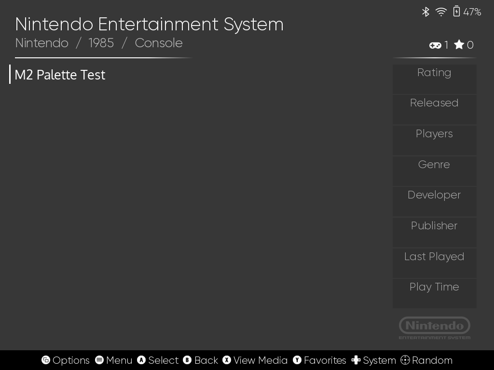
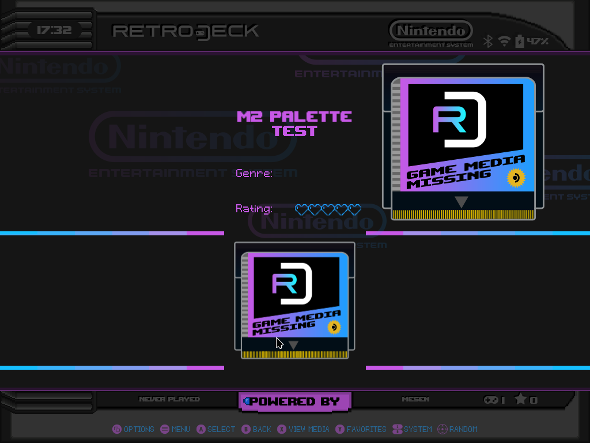

# M2 Steam Deck deployment record

**SSH device validation executed. Gaming Mode acceptance pending.** Recovered the prior Steam Deck destination from connection history and authenticated with strict saved-host-key checking. The user selected SSH-only testing. The physical Deck was in KDE Wayland Desktop Mode. All remote operations ran as the active unprivileged account.

## Inventory before installation

| Item | Device observation |
|---|---|
| Hardware and OS | Galileo, SteamOS 3.9.5 stable build 20261023.100, kernel 7.2.7-valve2-2-neptune-72-g31504582a073. Account deck, UID 1000. MemTotal 15,153,384 KiB. |
| Storage | 953.9 GiB NVMe, 155 GiB available on the home filesystem. 928.3 GiB microSD with 671 GiB available on its ext4 partition. |
| Existing software | Decky v3.3.1 system service active. EmuDeck settings report 2.5.0. ES-DE AppImage reports 3.4.1 r51. RetroArch 1.22.2, Dolphin, melonDS, xemu, PPSSPP, ScummVM, PrimeHack and Supermodel installed in user scope. Existing SRM configuration found. Standalone SRM launch unverified. |
| EmuDeck discovery | The real settings.sh selects the microSD Emulation/roms directory. The extracted backend resolved the same path and validated access to its nes console directory. Separate user-owned test roots were used for writes. |
| Development and connectivity | git, curl, python3 and flatpak available. HTTPS checks returned 200 for EmuDeck, Flathub, GitHub Decky and Internet Archive. Existing user Flathub remote points at dl.flathub.org. |

On the confirmed device, collect `id`, `cat /sys/class/dmi/id/product_name`, `cat /etc/os-release`, `uname -r`, `free -h`, `lsblk -o NAME,SIZE,FSTYPE,MOUNTPOINTS`, `df -hT`, `flatpak list --app`, `flatpak remotes --show-details`, and `command -v git curl python3 flatpak`. Record user/system installation scope and check existing suite settings, launcher and loader state before choosing installation steps. Use `bash rom-cli --library platforms` for the repository's discovery view. Compare its paths with each suite's own settings and effective access. Keep account names and personal paths out of shared logs.

## Installation and recovery record

Before any write, choose distinct disposable locations in the suites' supported setup flows. Record existing package versions, settings, grants, shortcuts and storage roots. With writers stopped, back up suite settings, Steam shortcut configuration and any existing ROM Library catalog and job data, including SQLite sidecars. Keep the previous plugin ZIP if upgrading. Confirm a restorable backup before changing installed components. Record each new component and exact test filename/digest so cleanup can be scoped to this run.

Install EmuDeck from its official SteamOS entry point. Record its active storage path, ES-DE and Steam ROM Manager configuration after setup. Install RetroDECK through Discover and run its Desktop Mode setup, recording the selected directory, Flatpak identity, installation scope, permissions and Steam shortcut. Check Decky compatibility against the observed SteamOS version. Obtain approval for any privileged installer or service change before executing it. Select ROM Library's inner ZIP through Decky's supported installer. [EmuDeck](https://www.emudeck.com/) · [RetroDECK first run](https://retrodeck.readthedocs.io/en/latest/wiki_devices/steamdeck/steamdeck-start/) · [Decky Loader](https://github.com/SteamDeckHomebrew/decky-loader)

For rollback, stop new jobs, let atomic publication finish, unload the plugin and check the worker and lock. Preserve failure evidence before retry. Restore the previous trusted ZIP and, with all writers stopped, restore catalog backups into a fresh directory as needed. Inspect each disposable file against its recorded digest before removal. Revert only settings and shortcuts recorded as changed. Removal of installed suites or changes to storage or grants require a separate review of the actual device inventory.

## Physical evidence outstanding

| Trial | Evidence to collect |
|---|---|
| Archive and controlled mirror, separately | Authorized playable fixture and expected digest, source/item, pagination, invalid metadata, cancellation and unavailable source |
| Internal SSD for both suites, microSD if present | Actual preview path, available bytes, confirmed job, checksum, duplicate, interruption, explicit retry, verified file and reconciliation |
| ES-DE and RetroDECK | Desktop and Gaming Mode discovery, refresh steps, emulator selection, successful launch and exit |
| Controller and loader | Quick Access, focus, OSK, Back, explicit enqueue, progress, cancel, retry, unload/reopen, plugin UID and worker count |
| Performance | AC/battery state, idle and transfer CPU, peak RSS, search and UI latency, throughput, verification, launch time and post-unload recovery |

## Executed command-line checks

The build from baseline `c741bdc` and validation commit `b540924` passed the Linux Python and frontend suites, TypeScript, bundling, and ZIP checks. The physical Deck independently matched ZIP SHA-256 `dad5f7e1e47675e5c8cd4de01977b265855c94e09d3eb7cdff533af70d21eeb5`. The transferred ZIP was staged privately for the official installer. Importing the extracted backend and resolving the real EmuDeck destination succeeded as UID 1000. A private recovery directory contains snapshots of EmuDeck settings and Steam shortcut files. [Candidate CI](https://github.com/Dukeraider2/rom-cli-sd/actions/runs/45296951924)

On the device, `python3 -B -m unittest discover -s tests -v` passed 33 tests in 4.573 seconds. These exercise the service with fixtures. Live Archive metadata search for “homebrew” returned an empty filtered first page with a next page, then six supported candidates. A separate live query for “Nova the Squirrel” returned nova.nes from item novathesquirrel1.0.6 in 438 ms. Explicit confirmation downloaded, verified and published 262,160 bytes to a disposable Deck library in 1.132 s. The provider supplied SHA-1 and MD5. Installed SHA-256 was `b7cf50596f2f7ec1a1b7f77e033c9a52f743bb15e9ef15ae0cb0cf6ce9609a98`. NovaSquirrel publishes the code under GPL-3.0-or-later and assets under CC BY-NC-SA 4.0. No game payload is included in Git. [Author and license](https://github.com/NovaSquirrel/NovaTheSquirrel#license) The separate loopback mirror served an original NES cartridge. From an isolated runner, `PYTHONPATH="/path/to/extracted/ROM Library" python3 device_m2_fixture.py /path/to/private/stage` exercised search, selection, preview, explicit enqueue and verified publication in a disposable library. The installer published SHA-256 `02ad100b04e699cc050733affe8b75030be62d7b23f1116515080ed8aac89f64`; a duplicate preview disabled installation. [Reproducible test fixture](../tests/device_m2_fixture.py)

RetroArch with the installed Nestopia core loaded the published file and exited zero after a bounded 120-frame offscreen run. The log recorded one second of content and core unload. Initial headless attempts failed on the input and Qt display drivers. The successful run used null video/input and Qt offscreen. Audio initialization emitted errors. An earlier attempt wrote RetroArch's normal content history and the final run saved Nestopia core options. The test ROM remained in the disposable library.

### Physical performance sample

Each row is one 8 MiB HTTP loopback transfer, verified and published through the backend on the physical Deck. AC was connected during this session. The benchmark includes the local HTTP server. The Linux CI baseline was 149.86 MiB/s and 53 ms. Device figures include filesystem behavior and the polling interval. They cannot establish sustained download speeds, UI latency or energy use. Run `TMPDIR=/private/test/directory python3 -B tests/benchmark_m2.py` on the intended filesystem.

| Destination | End to end | Throughput | CPU s | RSS peak bytes | Search ms | Progress median ms | Idle CPU ms/1s |
|---|---:|---:|---:|---:|---:|---:|---:|
| Internal SSD | 96 ms | 83.54 MiB/s | 0.071 | 32,374,784 | 2.21 | 0.628 | 0.12 |
| microSD | 391 ms | 20.45 MiB/s | 0.114 | 33,374,208 | 2.26 | 0.481 | 0.13 |

Both runs ended with zero active transfer workers and 11 queue mutation statements. A first run used tmpfs and measured 131.58 MiB/s. Physical card removal, game-load latency, battery behavior, graphical focus, actual controller input and full loader unload/reload are outstanding. [Host performance baseline and coverage](m2-verification.md)

Independent static review found no critical or high-severity issue in cancellation, shutdown or publication. Removing storage during cleanup can leave a journaled part owned by the still-running process. Remount the original volume, stop or reload the plugin to retire that process and reconcile the original attempt before retrying. A worker already publishing can retain its lease after the bounded unload wait. Verify it has exited before reloading.

### Device log excerpts

ES-DE launched with a private `--home`, disabled update checks and SDL offscreen. It logged `ViewController::preload(): Populating gamelist for system "nes"` before the 20-second test timeout. The separate Nestopia launch logged `Content ran for a total of: 00 hours, 00 minutes, 01 seconds.` and `Unloading core symbols...`. No input-to-frame or graphical launch measurement was made.

The extracted plugin entry point also completed two start/RPC/unload cycles with a test shim supplying Decky environment values. Each cycle returned success for version 1, `version` for version 2 and `invalid_request` for unexpected arguments. The worker was absent and the queue lease closed after unload. The live loader has yet to exercise these paths. [Raw physical storage samples](m2-steamdeck-storage.json)

### Application changes and rollback

The existing EmuDeck installation used the microSD and its settings identified version 2.5.0. The current official x86-64 AppImage was installed at the existing user-owned application path. Its internal desktop entry reported 2.7.1 and its installed SHA-256 matched `97ed9aee397052d99f0e5a580303a6ffe86b7f49d20c1a057b020b6e6270c98d`. Both backed-up EmuDeck settings files and Steam shortcuts remained byte-identical after the update. The prior executable is in the private recovery directory as `EmuDeck-original.AppImage`, SHA-256 `7b4b898567c2abcc7ebe791500b34ab2aadc8c2a23d1754d23d314215b4fcc66`. If rollback is required, close EmuDeck, verify both file identities, and restore that executable to its recorded original location. [Official EmuDeck release](https://github.com/EmuDeck/emudeck-electron/releases/tag/v2.7.1)

Steam ROM Manager's binary was missing. The installed EmuDeck backend specifies `Steam-ROM-Manager.AppImage` in the configured tools directory. Published the official x86-64 v2.6.3 file at that path without replacing an existing file. SHA-256 on the microSD matched `314b8fe6afb4ad7dcd06c66b6550c2771df7fce74593bfaf48ce6b1829c67a08`. Its AppImage runtime executed. Parser configuration, artwork and shortcut publication still require an interactive test. Rollback can remove this single new file after verifying its digest. [Official SRM release](https://github.com/SteamGridDB/steam-rom-manager/releases/tag/v2.6.3)

### Deployment candidate

The first candidate included build configuration and TypeScript sources. Commit `e12fbc6` moved those files into a companion source archive. After the complete Linux regressions, CI extracted the runtime ZIP and imported the backend in an isolated Python process. On the physical Deck the revised ZIP had 22 members, valid CRCs and 17 runtime Python/JavaScript files byte-identical to the previously tested candidate. A second mirror install with the revised package again verified the original NES digest and rejected its duplicate in preview.

The installable filename is `candidate/rom-library-m2.zip` inside the private device staging directory. Its SHA-256 is `ca3872f346206240a77e0fa95c33e53fd4db04cfbc66fb8b38136a73ee92d8d7`. The historical ZIP was renamed. The companion archive SHA-256 is `6108da777578f4e669b3f7ab39e39a4d09feffae5ad7dfa43af85fbf06ab54d9`. [Download the tested pair from the build run](https://github.com/Dukeraider2/rom-cli-sd/actions/runs/45300999912)

ES-DE was also exercised with a private SSH-controlled display and copies of the installed EmuDeck find rules. The screen showed one NES game, “M2 Palette Test”. The first launch reported “emulator not found” because ES-DE resolved the emulator and core relative to its disposable home. Both RetroArch and Mesen were installed on the Deck. After mapping their existing paths inside the test home, activating that title launched the real Mesen core through RetroArch. The running process arguments named the exact installed cartridge. The test process exited after inspection. This was virtual keyboard input on the physical Deck. The fitted controls and the Gaming Mode overlay still require separate validation.

## RetroDECK first run and game launch

The signed official user-scope Flatpak installed from Flathub with `flatpak install --user --noninteractive -y flathub net.retrodeck.retrodeck`. Version 0.10.10b, commit `edd2837718838f164bda1bde59ccb94e423f7fce4f349f5f7f585cf5b3b10c51`, KDE runtime 6.11, installed size 6.6 GB. The official graphical first-run wizard ran on a temporary virtual display on the Deck, operated through SSH. Selected internal storage and the Steam shortcut/controller templates. Skipped optional RPCS3 and Vita3K firmware and automatic favorites synchronization. The wizard reported successful setup and shortcut creation. A shortcut entry was present on disk. Steam requires a restart to show the change. The existing active session was left running. [Official first-run guide](https://retrodeck.readthedocs.io/en/latest/wiki_devices/steamdeck/steamdeck-start/)

The wizard created the setup lock and `~/.var/app/net.retrodeck.retrodeck/config/retrodeck/retrodeck.json`. The corrected package discovered the initialized internal ROM root and EmuDeck's separate microSD root. The installed Flatpak declares host filesystem access. Its effective `--file-access` to the NES directory was read-write. No grant override or root redirection was applied.

Verified the new RetroDECK NES directory contained no ROM before testing. From the isolated runner, invoked `device_m2_fixture.py STAGE --configured-suite retrodeck --expected-rom-root /home/deck/retrodeck/roms` with the extracted runtime ZIP on PYTHONPATH. Explicit confirmation published the original test cartridge, verified its digest and blocked a duplicate preview. A shell inside the real Flatpak independently read and hashed the installed bytes. RetroDECK's own ES-DE listed “M2 Palette Test”. Activating it launched “RetroArch Mesen 0.9.9” with the exact installed file as a process argument and rendered the expected blue palette screen. Startup to the frontend reported 1,966 ms on this run. The test emulator, RetroDECK instance and private compositor exited. Decky's system service remained active.

The private device staging directory is `/home/deck/m2-validation.UFqx9DzY`. It retains recovery snapshots and test logs, including `on-device-tests.log`, `es-private-launch.log`, `es-retest-summary.log`, `first-run.log`, and `retrodeck-install.json`. The original test cartridge remains in the newly initialized RetroDECK NES directory for supervised Gaming Mode validation. The runtime ZIP is `/home/deck/m2-validation.UFqx9DzY/candidate/rom-library-m2.zip`. The release gate is the official Decky ZIP installation and end-to-end Quick Access/controller workflow in the live Gaming Mode session. Physical Back, OSK, unplug/remount, AC/battery comparison and user-facing latency remain pending. Switching the active KDE session to Gaming Mode would close desktop applications.

## Live deployment preflight (2026-11-23)

Rechecked the requested source at `103367df23f503b74f71ec4a1a94c9e3fd6397e7`. At 17:46 PST the physical Galileo was in an active KDE Wayland seat. SSH ran as UID 1000. Decky 3.3.1 was active with zero recorded service restarts. Its plugins directory contained BGFX and decky-steamgriddb. ROM Library had no live job database, catalog or plugin log directory. The EmuDeck and Steam ROM Manager installed hashes matched the deployment record. RetroDECK reported 0.10.10b and effective read-write access to its NES directory. The EmuDeck settings, previous AppImage and Steam shortcut snapshots were present.

The staged 0.2.0 runtime ZIP matched the expected SHA-256, passed CRC validation for all 22 members and declared Decky API 1 with empty flags. Its actual compatibility with the live loader requires installation and a successful RPC. Both configured NES destinations were accessible and neither contained `nova.nes`. The authorized Archive item `novathesquirrel1.0.6` is therefore suitable for a new live confirmation in each suite. The earlier palette cartridge belongs to an isolated test catalog. It cannot establish a live installed-library result.

The on-device command `python3 -B -m unittest discover -s tests -v` passed 33 tests in 4.576 seconds. The private staging directory contains the full output in `live-preflight-regression.log`. It covers controlled cancellation/retry, unload during transfer, changed storage, checksum mismatch, interrupted staging and publication conflicts. Live lifecycle and physical input still need separate observations. Independent review identified no new critical or high-severity application regression at the starting commit. The remount/staging cleanup risk described above remains open.

## First live Decky installation and startup correction

The operator confirmed installation through Decky and reported that ROM Library appeared. On the Galileo, Decky 3.3.1 installed 0.2.0 and attempted backend initialization at 17:50:10 PST. The plugin log in `~/homebrew/logs/ROM Library/2026-11-23 17.50.10.log` recorded `ModuleNotFoundError: No module named 'html.parser'` from `library/providers.py` during the import of `main.py`. The live catalog and job database were absent at inspection. The active seat still reported KDE Wayland. Listing the plugin was successful; backend startup failed before RPC or job creation.

Read-only inspection of the installed loader's embedded CPython 3.14 archive found html and html.entities present, with html.parser, _markupbase and shlex absent. The 0.2.1 package includes those three pure-Python sources and the license from CPython v3.14.6. The plugin appends private fallback paths to the existing import search paths. Source selection, RPC validation, confirmation and queue code are unchanged. A targeted extracted-ZIP regression simulates all three omissions, imports the plugin entry point, decodes an escaped mirror link and parses a quoted suite path.

Commit `d9d39d6` passed the M1/M2 suite, frontend checks and packaging CI. The physical Deck independently matched staged ZIP SHA-256 `8b0b75d79a44f7b38fbcb84865c1b2b36b76dac9912c548a5a2935b48cee6747`. The Deck also passed `python3 -I -B check_decky_runtime.py "/path/to/extracted/ROM Library"` on that archive. The official installer can select `/home/deck/Downloads/ROM-Library-0.2.1.zip`. Live backend identity, successful startup RPC and controller acceptance require retesting this version after installation. [Build and regression results](https://github.com/Dukeraider2/rom-cli-sd/actions/runs/45322261696)

### Live 0.2.1 startup retest

The operator confirmed updating via Decky and opening the first screen. At 19:54:24 PST the installed version was 0.2.1. All 26 installed ZIP members matched the tested archive byte for byte. The live process named ROM Library had PID 77829, parent PID 36319 (PluginLoader), and real/effective/saved/filesystem UID 1000. Its latest plugin log, created at 19:53:44 PST, was empty at inspection. Its live queue database existed and a read-only count of the jobs table returned zero. This confirms recovery from the 0.2.0 startup failure. The installed-library catalog had yet to be created. The active seat reported KDE Wayland.

A single post-start process sample showed 45,344 KiB RSS and high-water RSS and one thread. External power was connected. File-descriptor inspection was unavailable to the observing SSH account. This sample establishes a live Desktop Mode baseline only. A successful frontend RPC, physical Gaming Mode navigation and the post-Back job count require the supervised interaction.

### Live Archive search and SteamOS certificate trust

The operator reported a certificate error. The live ROM Library display showed `CERTIFICATE_VERIFY_FAILED`, “self-signed certificate in certificate chain” at `_ssl.c:1082`. The earlier read-only queue count was zero. On the same physical Deck the system Python client could search Archive. Running a diagnostic with the loader's own _ssl extension and bundled OpenSSL 3.5.5 reproduced the exact failure. Its compiled default paths under /usr/lib/ssl resolved to neither a CA file nor a CA directory. The default context loaded zero CA roots. Explicitly loading the OS-managed /etc/ssl/cert.pem loaded 118 roots and negotiated TLS 1.3 with archive.org.

The 0.2.2 correction uses the SteamOS CA file only when both default trust paths are missing and neither CA environment override was supplied. TLS certificate and hostname verification remain mandatory. On the Deck the corrected CI ZIP matched SHA-256 `7fcf827e322dcf7f67972cb81fd75629736a23e5897f153c2f55a1a1f36705c6`. The extracted provider, using the loader's SSL libraries, returned nova.nes for the Archive query and rejected an intentionally mismatched hostname. The replacement is staged at `/home/deck/Downloads/ROM-Library-0.2.2.zip`. The user's live installer and frontend search retest are pending. [Correction and regression CI](https://github.com/Dukeraider2/rom-cli-sd/actions/runs/45323377044)

### Live controller preview and Back, 0.2.2

The short Archive query `nova` reproduced the visible empty first page with a next source page. The full title `Nova the Squirrel` returned `nova.nes`. The operator reported that both suites showed ready and that Back from the EmuDeck preview returned to destination selection. At 20:09:41 PST a read-only query of the live jobs database returned zero rows. Neither suite's configured NES directory contained `nova.nes`. The installed version was 0.2.2. This confirms live search, suite discovery, preview and Back without enqueue in the observed session. The active seat still reported KDE Wayland; native Gaming Mode remains unverified.

The operator reported that the confirmed EmuDeck job completed and appeared in Installed library. A follow-up SSH connection was refused before the file hash could be checked. In the 0.2.3 candidate, live Archive provider tests from Windows returned `nova.nes` on page one for `nova`, `Nova the Squirrel` and `squirrel nova`. The short query also retained access to later source pages. The updated plugin still needs a physical Deck retest.

The operator reported success on the requested on-Deck 0.2.3 short-title retest (Archive query `nova`). The live job database showed one completed EmuDeck NES install, 262160 of 262160 bytes. The microSD copy of nova.nes matched SHA-256 `b7cf50596f2f7ec1a1b7f77e033c9a52f743bb15e9ef15ae0cb0cf6ce9609a98`. The active seat reported KDE Wayland. RetroDECK installation and native Gaming Mode acceptance remain pending.

With the active seat running gamescope, the live Decky queue showed completed NES jobs for EmuDeck and RetroDECK, each 262160 of 262160 bytes with no recorded error. Both copies of nova.nes matched the expected SHA-256 `b7cf50596f2f7ec1a1b7f77e033c9a52f743bb15e9ef15ae0cb0cf6ce9609a98`. Reading the file inside the RetroDECK Flatpak independently produced the same digest. Opening the RetroDECK Steam shortcut started the Flatpak in Gaming Mode. Controller launch and exit for this cartridge remain to be observed.

The operator confirmed that Nova ran in RetroDECK on the physical Deck in Gaming Mode. At the follow-up check the seat still reported gamescope, and neither the ROM process nor the RetroDECK Flatpak was running. Movement and the screen reached on exit were not independently confirmed.
